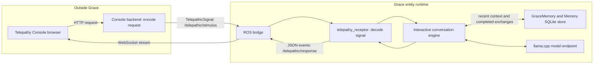

# Grace Telepathy boundary and architecture audit

Audited against AGi dev b7f7524, Shell dev 55b21bd and Telepathy dev 74cdd16.
This document describes the coordinated Console/Receptor migration.

## Audit findings

- AIVA/launch.sh starts rosbridge, Health's log collector, the receptor and
  Console. It may start or use a systemd-managed llama.cpp router.
- It does not source AuRoRA's workspace or launch ras.launch.py, scs/cnc,
  hrs/hrm or tms. Those packages still belong to AuRoRA, a separate runtime.
- Previously Console optionally imported hrs.hrm and tms.radio_encoding and
  exposed AuRoRA settings. This migration removes those imports and disables
  that settings editor. Console requires only the shared Cypher encoder.
- Shell no longer contains aiva_chat. Its implementation, memory adapter,
  persona and existing capability orchestration move to Telepathy.
- The receptor subscribes to /telepathic/stimulus. The /aiva/chat_input
  subscriber is removed. The retired response name /tms/text_response becomes
  /telepathic/response. Canvas snapshots retain /aiva/canvas_snapshot.
- Interactive, Memory and the signal codecs are libraries inside the receptor
  process. They are not separate ROS nodes. Console is a web process.
- Expected ROS nodes: /telepathy_receptor, /agi_log_collector,
  /rosbridge_websocket and /rosapi. Installed packages alone do not show use.

## Local migration and verification

Merge Console, Telepathy, Shell and AGi changes together in that order, then
update their local checkouts. Link Shell's src/telepathic_management to
../../console and src/telepathy_receptor to ../../telepathy. Remove only stale
build/aiva_chat and install/aiva_chat artifacts. Rebuild from a fresh terminal
sourced with /opt/ros/jazzy/setup.bash, so the old overlay is not inherited.

After startup inspect `ros2 node list`, `ros2 topic info /telepathic/stimulus -v`
and `ros2 topic info /telepathic/response -v`. Send a chat and restart to verify
history persistence on the actual PC. This cloud environment cannot establish
which manually started or separately managed processes exist on that PC.

The current codec is reversible encoding, not encryption. Encoding happens in
the console backend before ROS publication; browser-to-console HTTP still
contains text. Configure HTTPS when deploying that interface remotely.
