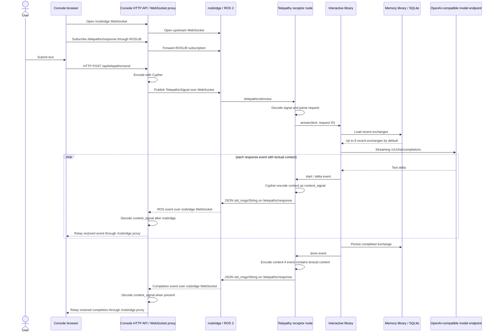

# Telepathy chat flow

This page records the source-level request/response path for Grace's current
PC runtime. For the complete process map and repository ownership, see
[`../../docs/ARCHITECTURE.md`](../../docs/ARCHITECTURE.md). The checked-in
component changes are merged on the component `dev` branches; this document
does not confirm which code or processes are currently running on a PC.

## Text conversation



Console encodes the submitted request before ROS publication. For each response
event, Telepathy encodes textual `content` as `content_signal`; Console decodes
it after rosbridge and restores `content` before forwarding the event to the
browser. Event types, request IDs, metrics, Canvas actions, and images remain
structured JSON fields. The Cypher scheme is reversible encoding, not
encryption. The original prompt travels from browser to Console over HTTP; use
HTTPS if that leg leaves a trusted local network.

Interactive assembles the persona, current time, recent exchanges, and current
prompt, calls the configured model endpoint, and persists the completed turn
through Memory. Memory is a Python library in the receptor process, not a
separate ROS node or database service. The default store is SQLite. Older turns
remain stored, but this chat path currently passes only the configured recent
window to the model; semantic retrieval is not part of this flow.

## Canvas requests

Canvas Studio sends requests over Console's `/api/canvas/ws` WebSocket. Console
encodes the request and publishes a `TelepathicSignal` on
`/telepathic/stimulus`, then decodes response text after rosbridge and relays
matching `/telepathic/response` events to the page. The receptor handles drawing
orchestration, calls the configured model with the Canvas action schema, and
publishes progress, actions, replies,
and completion events. When requested, raster painting uses the optional MOSS
sidecar; Canvas and Imaging packages and the painting sidecar are not ROS
nodes. The page sends review screenshots over the same Console WebSocket, and
Console publishes them on `/aiva/canvas_snapshot` for the pending draw request.

## Processes and topics

| Name | Kind | Role |
|---|---|---|
| `telepathic_console` | Standalone web process | Serves the external Console, encodes requests, and decodes response text around rosbridge |
| `/telepathy_receptor` | ROS 2 node | Decodes stimulus signals, runs chat/Canvas handling, encodes response text, publishes response events |
| `/agi_log_collector` | ROS 2 node | Collects ROS logs and publishes log events |
| `/rosbridge_websocket`, `/rosapi` | ROS 2 nodes | Connect the Console process to ROS 2 |
| `agi-interactive`, `agi-memory`, Cypher codecs | In-process libraries | Conversation, storage, and signal decoding |
| llama.cpp or configured compatible server | Separate model process/service | Chat and any configured model endpoints |

The old `aiva_chat` node and `/aiva/chat_input` subscriber are retired from
this flow. `/tms/text_response` is also retired; responses use
`/telepathic/response`. AuRoRA's SCS, HRM, and TMS launch path is separate and
is not started by AIVA.

## Check the local ROS graph

Run these after syncing the component `dev` branches and rebuilding the Shell
workspace. The launcher starts `telepathy_receptor` only when chat is enabled
with `AIVA_START_CHAT=1` (the default); if it is set to `0`, the receptor will
not appear in the ROS graph. Start Grace in a fresh terminal, then run:

```sh
ros2 node list
ros2 topic info /telepathic/stimulus -v
ros2 topic info /telepathic/response -v
ros2 topic info /aiva/canvas_snapshot -v
ros2 pkg list | rg '^(telepathy_receptor|telepathic_management|aiva_chat)$'
```

After a clean rebuild, `telepathy_receptor` and `telepathic_management` should
be installed; `aiva_chat` should not. A stale `build/` or `install/` overlay
can make retired packages appear, so verify from a terminal that has sourced
the intended ROS and workspace setup files.
