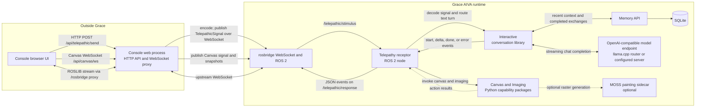
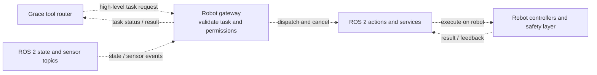

# Grace system architecture

**Status:** implementation map for the PC-side Grace runtime (AIVA), reviewed
against the component `dev` branches on 2026-11-20. This describes checked-in
code, not a live inspection of the PC. Planned robot integration is marked
separately.

Update this document when a component boundary, process, topic, or data path
changes. Keep proposed architecture visually separate from running code.

## Current chat request and response

Console encodes the request before publishing a Cypher `TelepathicSignal` on
`/telepathic/stimulus`. The current codec is reversible encoding, not
encryption; the browser-to-Console HTTP leg still carries the original text.
Use HTTPS when that leg crosses an untrusted network.

The Telepathy receptor decodes the signal and calls Interactive for ordinary
text turns. Interactive assembles the persona, current time, recent conversation
history, and user input, calls the configured OpenAI-compatible chat endpoint,
and streams events back through the receptor. Memory persists completed turns
in SQLite; the current default context window is eight exchanges. Older turns
remain stored but are not semantically recalled by this path.

Canvas requests are handled by the receptor's Canvas orchestration and the
installed Canvas and Imaging Python packages. MOSS raster painting is an
optional sidecar. These are not separate ROS nodes. The chat and Canvas flows
return structured JSON events on `/telepathic/response`. Canvas events use
request identifiers so the Console's Canvas page can route results to its
active request.

Standard chat submits text to `/api/telepathic/send` and receives ROS topic
events through the transparent `/rosbridge` proxy. Canvas Studio uses
`/api/canvas/ws`; that Console handler publishes the encoded request, subscribes
to response events, and relays the matching request's events to the page.

## ROS interfaces and streaming

Chat uses ROS 2 topics and messages, not a synchronous ROS service:

| Topic | Current type | Purpose |
|---|---|---|
| `/telepathic/stimulus` | `cryptic_signal_core/msg/TelepathicSignal` | Asynchronous user request into Grace |
| `/telepathic/response` | `std_msgs/msg/String` with a JSON event | `start`, `delta`, `done`, `error`, and Canvas events, with request identifiers |
| `/aiva/canvas_snapshot` | `std_msgs/msg/String` with a JSON/data URL | Browser-rendered Canvas snapshot for a pending drawing request |

The model endpoint streams its completion to Interactive over the
OpenAI-compatible HTTP streaming API. Interactive turns stream chunks into
events; the receptor publishes those events on `/telepathic/response`. The
chat browser subscribes to that ROS topic through Console's transparent
`/rosbridge` WebSocket proxy. For Canvas Studio, Console's `/api/canvas/ws`
handler subscribes to the same ROS response topic and forwards events matching
the Canvas request identifier.

A service would suit a short request with one final reply, but it would force a
streaming chat response to wait until generation completed. ROS 2 Actions could
represent a chat turn if the interface later needs standard goal status,
feedback, and cancellation. The current topic/event design is simpler for the
existing Console stream. If profiling shows transport overhead, batch tiny
model deltas briefly before publishing; do not add an RPC hop for each token.

## Runtime processes and ROS graph

`AIVA/launch.sh` coordinates the PC-side runtime. The exact model-router choice
depends on configuration: it can use an existing/systemd-managed llama.cpp
router, launch a local router, or skip starting one when an external model
endpoint is configured.

| Process or package | Runtime role | ROS node? |
|---|---|---:|
| `telepathic_console` from Console | Web server; forwards browser requests and ROS response events through rosbridge | No |
| `telepathy_receptor` from Telepathy | Decodes `/telepathic/stimulus`, runs chat/Canvas orchestration, publishes `/telepathic/response` | Yes |
| `agi_log_collector` from Health | Collects ROS logs and publishes system log events | Yes |
| `rosbridge_websocket` and `rosapi` | WebSocket gateway and ROS API exposed to Console | Yes |
| Interactive | Conversation engine imported by the receptor process | No; Python library |
| Memory | SQLite conversation and drawing-study storage imported by the receptor process | No; Python library |
| Cypher and Shell's signal-scheme registry | Signal message/codec and scheme selection | No; libraries/message package |
| Canvas and Imaging | Drawing and image-generation capabilities called by the receptor | No; Python packages (MOSS may run as a sidecar) |
| llama.cpp router / model server | OpenAI-compatible inference endpoint | No; separate process |
| `aiva_presence` | Optional HTTP heartbeat process | No |

The AIVA launcher does not start the separate AuRoRA robot runtime. AuRoRA's
SCS, HRM, and legacy TMS packages are not part of Grace's PC chat path. The
package name `telepathic_management` is retained for Console deployment; it
does not mean that AuRoRA's TMS is running.

## Repository ownership

| Component | Repository | Responsibility |
|---|---|---|
| Runtime assembly and local configuration | [OppaAI/AGi](https://github.com/OppaAI/AGi) | `AIVA/launch.sh`, setup, environment/path configuration, system-level documentation |
| ROS workspace and package links | [AGi-Robot/shell](https://github.com/AGi-robot/shell) | ROS build/runtime integration and launcher support |
| Grace entity receptor | [AGi-Robot/telepathy](https://github.com/AGi-robot/telepathy) | Signal decoding, chat adapter, Canvas orchestration |
| External WebUI | [AGi-Robot/console](https://github.com/AGi-robot/console) | Browser UI, request encoding, rosbridge transport |
| Conversation engine | [AGi-Robot/interactive](https://github.com/AGi-robot/interactive) | Prompt/context assembly, model request, streamed turn events |
| Conversation storage | [AGi-Robot/memory](https://github.com/AGi-robot/memory) | SQLite APIs for exchanges and related memory records |
| Signal schema and codec | [AGi-Robot/cypher](https://github.com/AGi-robot/cypher) | Shared `TelepathicSignal` and codecs |
| Logging and health | [AGi-Robot/health](https://github.com/AGi-robot/health) | ROS logging and system health components |
| Drawing and image capabilities | [AGi-Robot/canvas](https://github.com/AGi-robot/canvas), [AGi-Robot/imaging](https://github.com/AGi-robot/imaging) | Independently maintained capabilities used by the receptor |

Interactive and Memory are libraries loaded into the receptor process, not
independent ROS services. Console is outside Grace's entity; Telepathy's
receptor is part of it.

## Robot connection — proposed

No robot gateway or Grace-to-robot task API is represented as implemented here.
The following is a proposed boundary, not the current runtime:

For ROS-based robots on a suitable LAN, ROS 2 actions fit long-running tasks
that need feedback and cancellation; topics fit ongoing state, and services fit
short request/response operations. A direct local API can be simpler and have
less overhead for a capability on the same host. MCP would be an optional
agent-to-tool compatibility adapter, not a requirement for this architecture
and not a real-time robot-control transport. Avoid adding a router hop to
high-rate sensor or motor-control loops; enforce safety at the robot.

There are no latency measurements comparing these paths in this repository.
End-to-end delay also includes model generation, networking, serialization, and
robot execution; measure the actual deployment before choosing a transport for
a latency-critical operation.

## Source snapshot

The implementation map above was checked against these `dev` commits on
2026-11-20:

| Repository | Commit |
|---|---|
| OppaAI/AGi | `41558e1` |
| AGi-Robot/shell | `18e47ac` |
| AGi-Robot/telepathy | `708e80b` |
| AGi-Robot/console | `f4c2fdf` |
| AGi-Robot/interactive | `042b683` |
| AGi-Robot/memory | `95aa9f6` |
| AGi-Robot/health | `933964a` |
| AGi-Robot/cypher | `3fdc72d` |

This is a code snapshot, not proof that the same commits or processes are
currently installed on a particular machine. See [Telepathy flow](../AIVA/docs/telepathy-flow.md)
for the focused signal path and local ROS verification commands.
